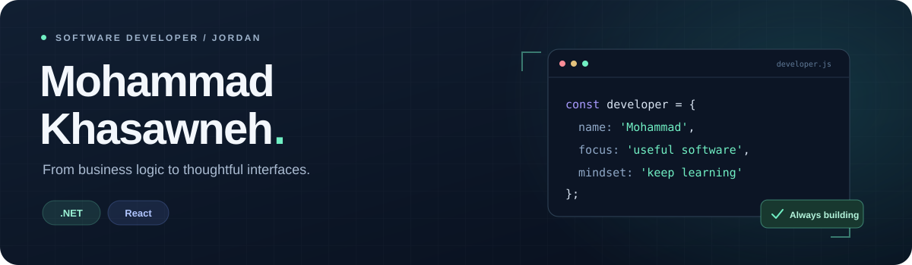
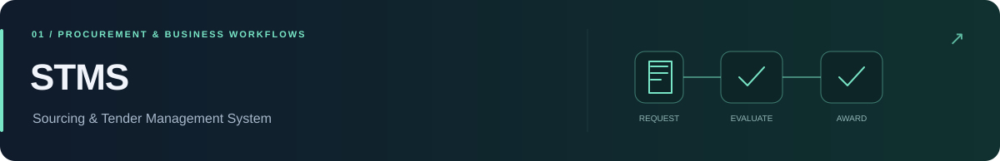
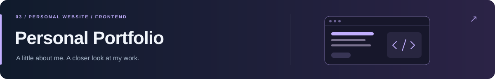
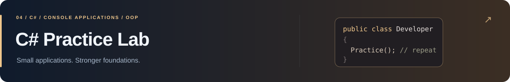

  <picture>
    <source media="(max-width: 600px)" srcset="assets/header-mobile.svg" />
    
  </picture>

  <a href="#projects">Projects</a> &nbsp; · &nbsp;
  <a href="#toolbox">Toolbox</a> &nbsp; · &nbsp;
  <a href="https://m-khasawneh.github.io/Simple-Portfolio/">Portfolio ↗</a> &nbsp; · &nbsp;
  <a href="#lets-connect">Let's connect</a>

 

I'm **Mohammad Khasawneh**, a software developer based in **Jordan**. I build web applications with **.NET and React**, connecting business logic, databases, and clear user interfaces.

 

## Projects

<h3>
  <a href="https://github.com/M-Khasawneh/STMS">
    <picture>
      <source media="(max-width: 600px)" srcset="assets/stms-mobile.svg" />
      
    </picture>
  </a>
</h3>

A procurement platform that brings purchase requests, supplier bids, evaluations, and award decisions into one role-based workflow.

`C#` &nbsp; `ASP.NET Core MVC` &nbsp; `EF Core` &nbsp; `SQL Server`

**[Explore the code ↗](https://github.com/M-Khasawneh/STMS)** &nbsp; · &nbsp; **[Live demo ↗](https://stms-khasawneh.runasp.net/)**

A closer look

- Supplier onboarding, tender invitations, and private bid documents.
- Department and committee access, dashboards, and notifications.
- Excel/PDF reports, responsive layouts, and light/dark modes.

Built with .NET 10, ASP.NET Core Identity, Razor Views, Bootstrap, JavaScript, HTML, and CSS.

 

<h3>
  <a href="https://github.com/M-Khasawneh/Graduation-Project">
    <picture>
      <source media="(max-width: 600px)" srcset="assets/triplus-mobile.svg" />
      
    </picture>
  </a>
</h3>

My graduation project: a tourism booking platform for discovering destinations, booking travel packages, and managing offers through customer, company, and admin interfaces.

`React` &nbsp; `Inertia.js` &nbsp; `Tailwind CSS`

**[Explore the code ↗](https://github.com/M-Khasawneh/Graduation-Project)**

A closer look

- Destination search, packages, and special offers.
- Bookings and cancellations, favorites, and reviews.
- Dedicated dashboards for tourism companies and administrators.

Additional technologies: JavaScript, Blade, and Vite.

 

<h3>
  <a href="https://github.com/M-Khasawneh/Simple-Portfolio">
    <picture>
      <source media="(max-width: 600px)" srcset="assets/portfolio-mobile.svg" />
      
    </picture>
  </a>
</h3>

A responsive home for my background, skills, experience, and projects, built with interactive sections and published on GitHub Pages.

`HTML5` &nbsp; `CSS3` &nbsp; `JavaScript` &nbsp; `Bootstrap`

**[Explore the code ↗](https://github.com/M-Khasawneh/Simple-Portfolio)** &nbsp; · &nbsp; **[Visit the website ↗](https://m-khasawneh.github.io/Simple-Portfolio/)**

 

<h3>
  <a href="https://github.com/M-Khasawneh/CSharp-Tasks">
    <picture>
      <source media="(max-width: 600px)" srcset="assets/csharp-mobile.svg" />
      
    </picture>
  </a>
</h3>

A collection of console applications for strengthening C# fundamentals, problem solving, and object-oriented programming.

`C#` &nbsp; `.NET` &nbsp; `OOP` &nbsp; `Console Applications`

**[Explore the code ↗](https://github.com/M-Khasawneh/CSharp-Tasks)**

What's inside?

- **[Adventure Game](https://github.com/M-Khasawneh/CSharp-Tasks/tree/main/AdventureGame)** — character classes, inheritance, and interfaces.
- **[Employee Management](https://github.com/M-Khasawneh/CSharp-Tasks/tree/main/EmployeeManagementSystem)** — abstraction and salary calculations.
- **[School System](https://github.com/M-Khasawneh/CSharp-Tasks/tree/main/SchoolSystem)** — student and teacher models, constructors, and access modifiers.
- **[Shopping Calculator](https://github.com/M-Khasawneh/CSharp-Tasks/tree/main/Task%231)** — console input, loops, and purchase totals.

 

## Toolbox

  

  <strong>Backend logic. Frontend detail. Everything in between.</strong>

Full technology stack

| Area | Technologies |
| --- | --- |
| Languages | C#, JavaScript, HTML, CSS, T-SQL |
| Backend | .NET, ASP.NET Core MVC, EF Core, ASP.NET Core Identity |
| Frontend | React, Inertia.js, Tailwind CSS, Bootstrap |
| Databases | Microsoft SQL Server |
| Templates & scripting | Razor Views, Blade, PowerShell |
| Tools | Git, GitHub, Vite |

 

## Let's connect

Have a project in mind, a question about my work, or just want to say hello?

  
  &nbsp;
  
  &nbsp;
  

**Email:** [m.khasawneh.a@gmail.com](mailto:m.khasawneh.a@gmail.com) 
**LinkedIn:** [linkedin.com/in/mohammad-khasawneh](https://www.linkedin.com/in/mohammad-khasawneh/)
